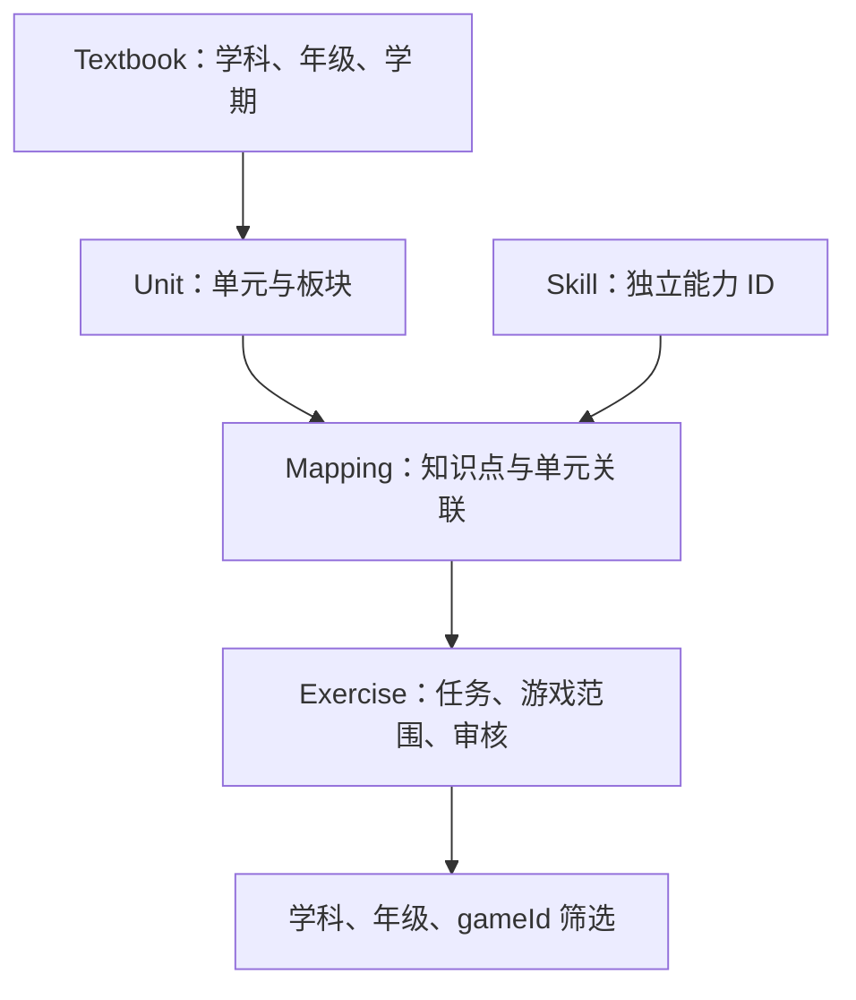

# 架构说明

更新日期：2026-10-25。本说明区分当前实现与规划，字段定义以 [models.ts](../src/learning/models.ts) 为准。

## 当前实现

工程是 TypeScript ESM 数据层，无运行时第三方依赖。Node.js 22+ 为 package.json 中声明的最低要求；已执行检查的环境为 Node.js 24.22.1。TypeScript 锁定为 5.9.3。

| 位置 | 职责 |
| --- | --- |
| src/content/ | 教材、单元、知识点、映射、练习与证据静态数据 |
| src/learning/models.ts | 数据类型与筛选查询 |
| src/learning/catalog.ts | 引用检查、Core 创建、正式和候选筛选 |
| src/learning/evaluation.ts | 安全整数答案计算与判题 |
| src/index.ts | 汇总默认 catalog 与导出 API |
| tests/learning.test.mjs | 对编译结果执行 Node.js 测试 |
| dist/ | 编译生成物，忽略提交 |

当前 build 仅运行 tsc，产出 JavaScript 与声明文件；不是 H5 打包、资源压缩或可部署站点构建。

## 数据关系

箭头表示内容关联路径。Mapping 用 unitIds 支持一个知识点关联多个单元；多个 Mapping 可指向同一单元或知识点。Exercise 用 mappingIds 引用关联记录。年级来自单元所属教材，不固定在 Skill 上。

证据通过教材、单元、映射的 evidenceIds 关联。当前证据类型只有 conversation-handoff；不能直接填写尚未支持的官方文档类型冒充结构已完善。

## API 契约与边界

| API | 当前行为 |
| --- | --- |
| validateCatalog(catalog) | 返回重复 ID、悬空关联、部分学科不一致、缺失证据、无效审核元数据和数学任务错误列表 |
| createLearningCore(catalog) | 检查失败即抛错；成功后返回两个筛选函数 |
| selectExercises(query) | 只返回 approved，且匹配学科、gameId 与至少一个所选年级关联 |
| previewExercises(query) | 同样筛选，但包含 draft；不是正式取题的备用路径 |
| answerFor(task) | 计算安全整数结果；无效任务、运算符或溢出抛错 |
| evaluateAnswer(task, answer) | 接受安全整数或去除首尾空白后的十进制整数字符串；无效作答返回 false，无效题目仍抛错 |

筛选无随机化、分页或数量限制，保持数据顺序。空年级、非法年级或空白 gameId 抛错；未知游戏、没有内容的年级返回空数组。重复年级不造成结果重复。

当前 Exercise.subject 仅为 math，MathTask 只有 number、binary、chain 三类。语文、英语虽然有索引和知识点，但还没有题型及判题实现。支持三科索引不等于支持三科练习。

这些 API 面向受信任、经 TypeScript 检查的静态数据。validateCatalog 不是不可信 JSON 的完整 schema 校验器，也不检查全部课程语义、教材真实性或审批权限。

数组有 readonly 类型约束，但对象没有深度冻结，也没有防篡改或深拷贝保证。创建 Core 后不得修改底层数据；修改内容后重建 Core，否则预建关联索引可能与数据不一致。

## 后续架构方向

| 边界 | 规划职责 | 引入时机 |
| --- | --- | --- |
| 游戏规则 | 单局状态、出题、计分、胜负；尽量纯函数 | M3 |
| 浏览器界面 | 常规控件使用 DOM，游戏区域按计划使用 Canvas 2D | M3–M4 |
| 本地存储 | 设置、局次、内容版本与迁移 | M5 |
| 离线资源 | 缓存、版本切换与缺失处理 | M6 |
| 非数学任务 | 按具体游戏增加明确任务类型与判题 | M8–M15 |

以上模块尚不存在。浏览器构建工具、存档格式、内容版本字段、缓存策略和托管环境均未确定；在相应里程碑落定时补充，不提前编造配置或命令。

## 需要保持的边界

- 数学答案由结构化任务确定，不存可执行表达式，也不在动画代码重复一套判题。
- 教学正确性由内容审核支持；代码检查只承担可以验证的数据与计算约束。
- 游戏请求受筛选结果约束；无内容时明确提示，不静默扩大年级范围。
- 后端不是首阶段依赖；共享能力从第二款游戏的实际复用中提取。
