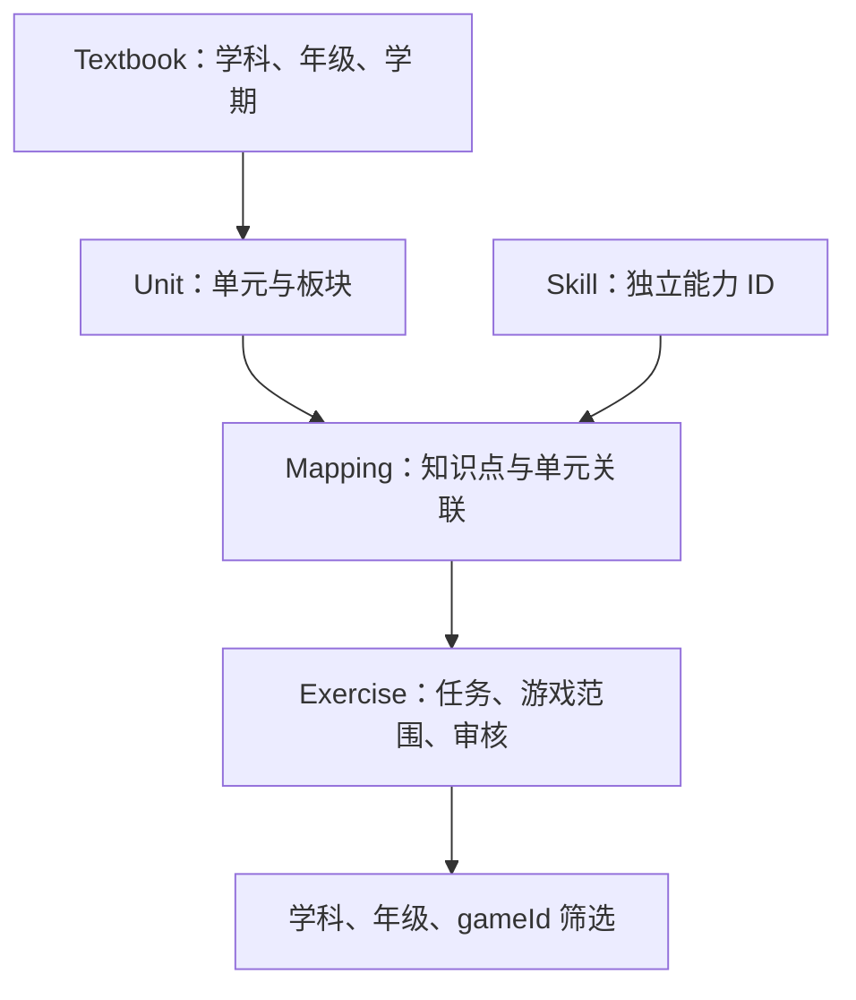

# 架构说明

更新日期：2026-10-26。本说明区分当前实现与规划，Learning Core 字段以 [models.ts](../src/learning/models.ts) 为准，游戏侧课程和档案类型见下表。

## 当前实现

工程是 TypeScript ESM 静态 H5 与纯 TypeScript 学习数据层，无运行时第三方依赖。Node.js 22+ 为 package.json 中声明的最低要求；已执行检查的环境为 Node.js 24.2.0。TypeScript 锁定为 5.9.3。

| 位置 | 职责 |
| --- | --- |
| src/content/ | 教材、单元、知识点、映射、练习与证据静态数据 |
| src/learning/models.ts | 数据类型与筛选查询 |
| src/learning/catalog.ts | 引用检查、Core 创建、正式和候选筛选 |
| src/learning/arithmetic.ts、evaluation.ts、choice.ts | 安全整数运算、结构化选择题校验、选项答案推导与统一判题；不依赖界面或存储 |
| src/index.ts | 汇总默认 catalog 与导出 API |
| src/game/number-puzzle/rules.ts | 数字消除纯规则：单局状态机、局序洗牌、判题、计分、保证规则、注入随机源；无 DOM 依赖 |
| src/game/number-puzzle/session.ts | 纯计时逻辑 RoundSession：注入时钟、绝对截止时间、剩余时间、暂停冻结和恢复；无 DOM 或真实计时器 |
| src/game/number-puzzle/random.ts | 种子 PRNG（mulberry32）与运行时熵随机源；M5 支持内部状态快照（snapshotState）与按状态恢复（restoreSeededRng），中断续局的随机序列与连续游玩完全一致 |
| src/game/number-puzzle/content.ts | 游戏层内容适配：可用性四场景文案、练习 → 年级索引、默认内容装配 |
| src/game/number-puzzle/choice-generation.ts | 比较、筛选、判断、数列、数位、算式、图示和情境等 17 类选择题候选；范围与审核见扩展审核记录 |
| src/game/number-puzzle/generation.ts | 数字消除本地生成规则：有限候选构造、按年级及题型配额抽取、上一局优先避重；纯 TypeScript，无 DOM、存储或网络依赖 |
| src/game/number-puzzle/audio.ts | WebAudio 合成音效（答对/答错/结算）：可关闭，无音频文件、无新增依赖，仅反馈增强不承载规则信息 |
| src/game/number-puzzle/garden.ts | 数字花园静态 Canvas 装饰：浅色底、边缘植物、蓝蓝与季节装饰，无游戏状态或判题依赖；由 render.ts 在题面与棋盘之前绘制，随静态导入进入离线预缓存 |
| src/game/number-puzzle/render.ts | Canvas 2D 游戏区渲染：按容器重排题目区、乘法点阵与十二块棋盘（竖屏三列／低高度横屏四列），绘制／命中／键盘共用布局；包含动画，✓/✗ 形状 + 文案反馈条；只读规则状态，不判题；M4 增加暂停冻结与显示尺寸自适应 |
| src/game/number-puzzle/main.ts | DOM 页面、Canvas 输入、有限挑战和计时接线、课程／复习、商店和资料、后台暂停、异步事务与错误提示、离线与更新 |
| src/game/number-puzzle/storage.ts | v1 设置、成绩和避重 ID 的只读导入；持久化 MathTask 输入校验；不恢复旧局次，不写入或清理旧键 |
| src/game/number-puzzle/profile.ts | 纯金币／道具／奖励／错题操作与档案校验；ProfileStore 隔离异步存储，原生 IndexedDB readwrite 事务和修订号检查提供原子提交及跨页面冲突拒绝 |
| src/game/number-puzzle/learning.ts | 21 节课程、按映射及题型动态抽题、稳定题目身份、题面文本和程序化解题说明；无 DOM 或存储依赖 |
| src/game/number-puzzle/offline.ts | 离线状态与版本更新纯逻辑（M6）：缓存名前缀与版本标记格式、旧版本缓存清理决策（staleCacheNames）、更新采用时机（decideUpdateAdoption：仅选择屏且无进行中局次 adopt）与执行决策（planAdoptionExecution：waiting 缺失且新版本已接管则刷新、未接管则收敛——waiting 可被浏览器跳过直通激活）、离线状态文案推导（describeOfflineStatus，含更新提示优先）；无 DOM、无 Service Worker 依赖，浏览器接线在 main.ts，SW 侧策略在 web/sw.source.js（两处头注交叉说明） |
| web/index.html、web/style.css | 静态 H5 入口页面与样式（M5 增加存储提示、恢复提供、练习记录与清除入口；M6 增加离线状态提示行与主模块加载失败的内联兜底脚本） |
| web/sw.source.js | 离线 Service Worker 模板（M6，跟踪提交）：install 预缓存清单（任一失败不激活）、不自动 skipWaiting、activate 清理同前缀旧缓存并广播 cache-ready、同源 GET 缓存优先 + 未命中回填、导航回退入口页与离线兜底页；由 build 脚本替换占位符后生成 web/sw.js（构建产物，gitignore） |
| scripts/build-sw.mjs | 构建（M6）：从 dist 入口解析静态 import 闭包生成预缓存清单（入口页与 /style.css 之外全部为 dist 模块，练习数据随构建进入产物），对清单内容与模板哈希计算版本标记（assets-v1-<12 位十六进制>），写出 web/sw.js；任一清单文件缺失即构建失败 |
| scripts/serve.mjs | Node 内置 http 本地静态服务（npm run serve） |
| tests/learning.test.mjs、tests/number-puzzle.test.mjs、tests/session.test.mjs、tests/storage.test.mjs、tests/offline.test.mjs | 对编译结果执行 Node.js 测试；offline.test.mjs 同时从 scripts/build-sw.mjs 导入函数并与真实 dist 产物及生成的 web/sw.js 核对 |
| dist/ | 编译生成物，忽略提交；web/sw.js 为离线 SW 生成物，忽略提交 |

build 先运行 tsc，再由 scripts/build-sw.mjs 生成 web/sw.js（预缓存清单 + 版本标记）；产出 JavaScript 与声明文件加离线 Service Worker，不是 H5 打包、资源压缩或可部署站点构建。页面以原生 ES 模块直接加载 dist 产物，由 scripts/serve.mjs 在本地提供，浏览器侧无打包器、无第三方依赖。

## 数据关系

数字消除正式内容装配先用 `generateExercises` 构造经规则审核的有限候选，再调用 `createLearningCore` 校验并通过 `selectExercises` 筛选；开局用 `selectRoundExercises` 按年级及作答类别配额，先选不同题型再选候选，按语义身份去重后抽 10 题，再交给原有 `createRound` 洗牌和建立棋盘。生成模块属于本游戏，不扩展为通用引擎；默认 `src/index.ts` 导出的 catalog、selectExercises 仍是首批静态内容。静态题库另用于显式候选预览与旧中断局次的精确指纹兼容检查，不作为动态缺题降级。

题目 ID 由生成规则版本、映射及参数决定。错题身份另按任务类型、参数与顺序确定，不以生成版本或局次 ID 重置领奖资格。正式题与复习原题都经 selectExercises；撤回审核范围的原题仅保留历史，不自动换题或降级。

新版档案保存在 IndexedDB 的 pixel-academy 数据库、profiles store、local 记录中，结构版本为 2。钱包、库存、购买／装备、昵称、课程、错题、领奖标记、当前局和成绩同属一个事务记录；每次提交检查 revision，事务失败不发布新状态，多页面陈旧提交拒绝并同步。成绩最多保留 100 条，奖励凭据独立保留。存储不可用时只临时学习／挑战，不允许交易或持久领奖。

首次创建档案时只读导入旧 localStorage 设置、历史成绩与避重信息，不恢复旧中断局，不补发历史金币；后续已有档案不重复导入。清除成绩不清除钱包或领奖资格，明确确认的全部重置使用独立事务；旧 localStorage 键保持不动。

当前挑战保存完整题目、棋盘、RNG 状态、复活与道具标记、剩余时间及绝对截止时间；内容版本组合生成规则版本和挑战规则版本，更新规则应同步升级版本。恢复默认暂停，意外中止留下的运行状态按截止时间扣除经过时间，不刷新题目或重置倒计时。课程小练习保存当前题与独立完成情况。选择题的候选存于任务中；多选未提交选择及实际提交答案随当前局／练习保存。schemaVersion 保持 2，新增字段可选以读取旧档案；金币、课程与领奖凭据不重置。生成与挑战规则版本变化按现有策略提示后放弃不兼容中断挑战，其余档案保留。进行中的挑战／小练习阻止本页主动采用等待中的 Service Worker 更新。

箭头表示内容关联路径。Mapping 用 unitIds 支持一个知识点关联多个单元；多个 Mapping 可指向同一单元或知识点。Exercise 用 mappingIds 引用关联记录。年级来自单元所属教材，不固定在 Skill 上。

证据通过教材、单元、映射的 evidenceIds 关联。当前证据类型只有 conversation-handoff；不能直接填写尚未支持的官方文档类型冒充结构已完善。

## API 契约与边界

| API | 当前行为 |
| --- | --- |
| validateCatalog(catalog) | 返回重复 ID、悬空关联、部分学科不一致、缺失证据、无效审核元数据和数学任务错误列表 |
| createLearningCore(catalog) | 检查失败即抛错；成功后返回两个筛选函数 |
| selectExercises(query) | 只返回 approved，且匹配学科、gameId 与至少一个所选年级关联 |
| previewExercises(query) | 同样筛选，但包含 draft；不是正式取题的备用路径 |
| answerFor(task) | 保留原整数 API，只计算整数任务；选择题、无效任务、运算符或溢出抛错 |
| validateTask(task) | 校验整数或选择题的合法性、固定候选及答案可达性；失败抛错 |
| evaluateAnswer(task, answer) | 整数任务接受安全整数或十进制整数字符串；选择题接受单个选项 ID 或多选 ID 集合；无效作答返回 false，无效题目仍抛错 |

筛选无随机化、分页或数量限制，保持数据顺序。空年级、非法年级或空白 gameId 抛错；未知游戏、没有内容的年级返回空数组。重复年级不造成结果重复。

当前 Exercise.subject 仅为 math，MathTask 包含原整数任务 number、binary、chain，以及保存结构化题意和固定候选的 choice。语文、英语虽然有索引和知识点，但还没有题型及判题实现。支持三科索引不等于支持三科练习。

这些 API 面向受信任、经 TypeScript 检查的静态数据。validateCatalog 不是不可信 JSON 的完整 schema 校验器，也不检查全部课程语义、教材真实性或审批权限。

数组有 readonly 类型约束，但对象没有深度冻结，也没有防篡改或深拷贝保证。创建 Core 后不得修改底层数据；修改内容后重建 Core，否则预建关联索引可能与数据不一致。

## 后续架构方向

| 边界 | 规划职责 | 状态 |
| --- | --- | --- |
| 游戏规则 | 单局状态、出题、计分、胜负；尽量纯函数 | M3 已落地（src/game/number-puzzle/rules.ts） |
| 浏览器界面 | 常规控件使用 DOM，游戏区域按计划使用 Canvas 2D | M3 提供最小实现；M4 完成复古掌机视觉、手机交互（暂停/继续/重新开始/返回、切后台自动暂停、自适应布局）与可关闭合成音效 |
| 本地存储 | 档案、事务、内容版本与旧数据导入 | 新版由 profile.ts 的 IndexedDB 事务承载；storage.ts 仅保留旧格式读取，旧中断恢复与写入分支已移除 |
| 离线资源 | 缓存、版本切换与缺失处理 | M6 已落地（web/sw.source.js + scripts/build-sw.mjs 生成 web/sw.js；策略纯逻辑在 src/game/number-puzzle/offline.ts）：缓存名带构建哈希版本、install 全量预缓存（任一失败不激活）、不自动 skipWaiting（页面在非单局中途时机采用）、activate 清理旧版本缓存、缓存优先 + 未命中回填、离线导航兜底页；内容随构建进入产物，无在线内容请求 |
| 非数学任务 | 按具体游戏增加明确任务类型与判题 | M8–M15 |

M5 的旧 localStorage 档案保留为只读导入来源，新版原子档案和计时版本约束见上文“数据关系”。M6 的资源版本链路继续使用完整静态导入闭包哈希，缓存完成后支持本地学习、挑战、交易与记录；首次未缓存不承诺离线。

游戏规则、浏览器界面、计时、音效和课程均限于本游戏实际需要，没有引入后端或通用游戏引擎。其他游戏仍在 M8–M15，出现真实复用需求时再提取公共能力。

## 需要保持的边界

- 数学答案由结构化任务确定，不存可执行表达式，也不在动画代码重复一套判题。
- 教学正确性由内容审核支持；代码检查只承担可以验证的数据与计算约束。
- 游戏请求受筛选结果约束；无内容时明确提示，不静默扩大年级范围。
- 后端不是首阶段依赖；共享能力从第二款游戏的实际复用中提取。
