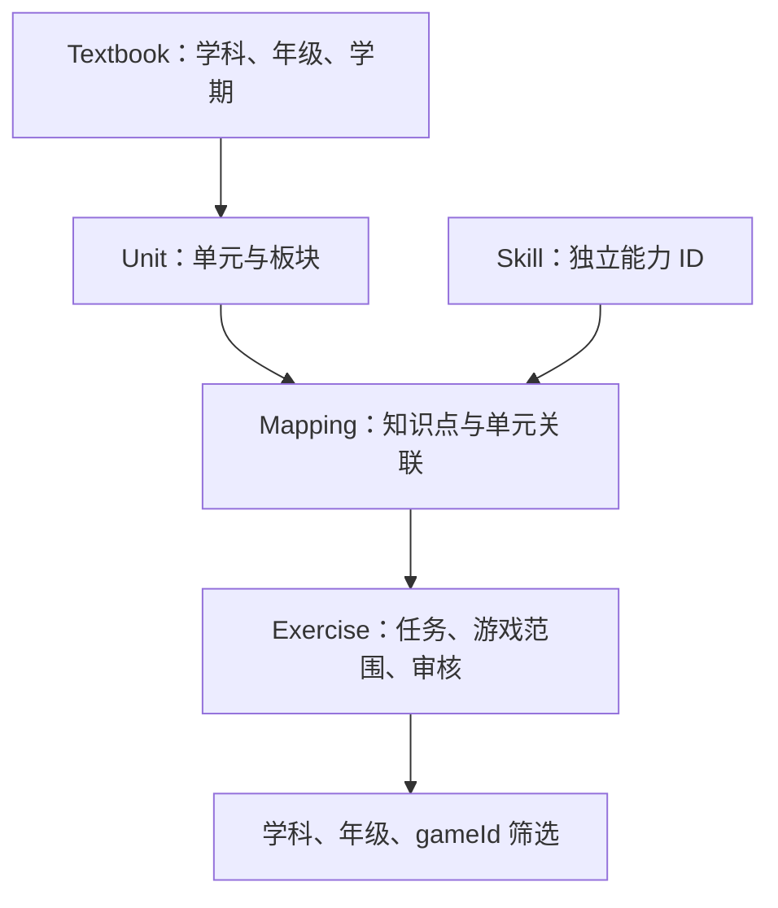

# 架构说明

更新日期：2026-10-25。本说明区分当前实现与规划，字段定义以 [models.ts](../src/learning/models.ts) 为准。

## 当前实现

工程是 TypeScript ESM 数据层，无运行时第三方依赖。Node.js 22+ 为 package.json 中声明的最低要求；已执行检查的环境为 Node.js 24.22.1。TypeScript 锁定为 5.9.3。

| 位置 | 职责 |
| --- | --- |
| src/content/ | 教材、单元、知识点、映射、练习与证据静态数据 |
| src/learning/models.ts | 数据类型与筛选查询 |
| src/learning/catalog.ts | 引用检查、Core 创建、正式和候选筛选 |
| src/learning/evaluation.ts | 安全整数答案计算与判题 |
| src/index.ts | 汇总默认 catalog 与导出 API |
| src/game/number-puzzle/rules.ts | 数字消除纯规则：单局状态机、局序洗牌、判题、计分、保证规则、注入随机源；无 DOM 依赖 |
| src/game/number-puzzle/session.ts | 单局会话状态机（纯逻辑）：运行/暂停切换、切后台自动暂停、动画计时器的冻结换算；时钟注入，无 DOM、无 setTimeout |
| src/game/number-puzzle/random.ts | 种子 PRNG（mulberry32）与运行时熵随机源；M5 支持内部状态快照（snapshotState）与按状态恢复（restoreSeededRng），中断续局的随机序列与连续游玩完全一致 |
| src/game/number-puzzle/content.ts | 游戏层内容适配：可用性四场景文案、练习 → 年级索引、默认内容装配 |
| src/game/number-puzzle/audio.ts | WebAudio 合成音效（答对/答错/结算）：可关闭，无音频文件、无新增依赖，仅反馈增强不承载规则信息 |
| src/game/number-puzzle/render.ts | Canvas 2D 游戏区渲染：题目区、乘法点阵、棋盘与动画，✓/✗ 形状 + 文案反馈条；只读规则状态，不判题；M4 增加暂停冻结与显示尺寸自适应 |
| src/game/number-puzzle/main.ts | 浏览器入口：DOM 界面流转、局次生命周期与输入窗口计时、暂停/继续/重新开始/返回、visibilitychange 自动暂停、音效开关；M5 接线本地记录（设置即改即存、逐状态更新中断快照、结算写成绩、恢复提供、清除入口与不可用提示），预览入口不读写正式记录存储 |
| src/game/number-puzzle/storage.ts | 本地记录与恢复纯逻辑（M5）：版本化键与 schemaVersion、设置/成绩/中断快照的结构校验（损坏与非法字段按首次使用或逐条丢弃）、内容版本指纹与恢复前置检查、同 recordId 幂等去重与成绩上限、注入式 KV 门面 GameStorage（写入失败自动停用持久化）；无 DOM、无 localStorage 直接依赖，注入 localStorage 适配器在 main.ts |
| src/game/number-puzzle/offline.ts | 离线状态与版本更新纯逻辑（M6）：缓存名前缀与版本标记格式、旧版本缓存清理决策（staleCacheNames）、更新采用时机（decideUpdateAdoption：仅选择屏且无进行中局次 adopt）与执行决策（planAdoptionExecution：waiting 缺失且新版本已接管则刷新、未接管则收敛——waiting 可被浏览器跳过直通激活）、离线状态文案推导（describeOfflineStatus，含更新提示优先）；无 DOM、无 Service Worker 依赖，浏览器接线在 main.ts，SW 侧策略在 web/sw.source.js（两处头注交叉说明） |
| web/index.html、web/style.css | 静态 H5 入口页面与样式（M5 增加存储提示、恢复提供、练习记录与清除入口；M6 增加离线状态提示行与主模块加载失败的内联兜底脚本） |
| web/sw.source.js | 离线 Service Worker 模板（M6，跟踪提交）：install 预缓存清单（任一失败不激活）、不自动 skipWaiting、activate 清理同前缀旧缓存并广播 cache-ready、同源 GET 缓存优先 + 未命中回填、导航回退入口页与离线兜底页；由 build 脚本替换占位符后生成 web/sw.js（构建产物，gitignore） |
| scripts/build-sw.mjs | 构建（M6）：从 dist 入口解析静态 import 闭包生成预缓存清单（入口页与 /style.css 之外全部为 dist 模块，练习数据随构建进入产物），对清单内容与模板哈希计算版本标记（assets-v1-<12 位十六进制>），写出 web/sw.js；任一清单文件缺失即构建失败 |
| scripts/serve.mjs | Node 内置 http 本地静态服务（npm run serve） |
| tests/learning.test.mjs、tests/number-puzzle.test.mjs、tests/session.test.mjs、tests/storage.test.mjs、tests/offline.test.mjs | 对编译结果执行 Node.js 测试；offline.test.mjs 同时从 scripts/build-sw.mjs 导入函数并与真实 dist 产物及生成的 web/sw.js 核对 |
| dist/ | 编译生成物，忽略提交；web/sw.js 为离线 SW 生成物，忽略提交 |

build 先运行 tsc，再由 scripts/build-sw.mjs 生成 web/sw.js（预缓存清单 + 版本标记）；产出 JavaScript 与声明文件加离线 Service Worker，不是 H5 打包、资源压缩或可部署站点构建。页面以原生 ES 模块直接加载 dist 产物，由 scripts/serve.mjs 在本地提供，浏览器侧无打包器、无第三方依赖。

## 数据关系

箭头表示内容关联路径。Mapping 用 unitIds 支持一个知识点关联多个单元；多个 Mapping 可指向同一单元或知识点。Exercise 用 mappingIds 引用关联记录。年级来自单元所属教材，不固定在 Skill 上。

证据通过教材、单元、映射的 evidenceIds 关联。当前证据类型只有 conversation-handoff；不能直接填写尚未支持的官方文档类型冒充结构已完善。

## API 契约与边界

| API | 当前行为 |
| --- | --- |
| validateCatalog(catalog) | 返回重复 ID、悬空关联、部分学科不一致、缺失证据、无效审核元数据和数学任务错误列表 |
| createLearningCore(catalog) | 检查失败即抛错；成功后返回两个筛选函数 |
| selectExercises(query) | 只返回 approved，且匹配学科、gameId 与至少一个所选年级关联 |
| previewExercises(query) | 同样筛选，但包含 draft；不是正式取题的备用路径 |
| answerFor(task) | 计算安全整数结果；无效任务、运算符或溢出抛错 |
| evaluateAnswer(task, answer) | 接受安全整数或去除首尾空白后的十进制整数字符串；无效作答返回 false，无效题目仍抛错 |

筛选无随机化、分页或数量限制，保持数据顺序。空年级、非法年级或空白 gameId 抛错；未知游戏、没有内容的年级返回空数组。重复年级不造成结果重复。

当前 Exercise.subject 仅为 math，MathTask 只有 number、binary、chain 三类。语文、英语虽然有索引和知识点，但还没有题型及判题实现。支持三科索引不等于支持三科练习。

这些 API 面向受信任、经 TypeScript 检查的静态数据。validateCatalog 不是不可信 JSON 的完整 schema 校验器，也不检查全部课程语义、教材真实性或审批权限。

数组有 readonly 类型约束，但对象没有深度冻结，也没有防篡改或深拷贝保证。创建 Core 后不得修改底层数据；修改内容后重建 Core，否则预建关联索引可能与数据不一致。

## 后续架构方向

| 边界 | 规划职责 | 状态 |
| --- | --- | --- |
| 游戏规则 | 单局状态、出题、计分、胜负；尽量纯函数 | M3 已落地（src/game/number-puzzle/rules.ts） |
| 浏览器界面 | 常规控件使用 DOM，游戏区域按计划使用 Canvas 2D | M3 提供最小实现；M4 完成复古掌机视觉、手机交互（暂停/继续/重新开始/返回、切后台自动暂停、自适应布局）与可关闭合成音效 |
| 本地存储 | 设置、局次、内容版本与迁移 | M5 已落地（src/game/number-puzzle/storage.ts）：键 `pixel-academy:number-puzzle:v1:{settings|records|interrupted}`，结构带 schemaVersion；内容版本为正式题集指纹，不兼容时仅放弃中断局次；成绩按 recordId 幂等、上限 100 条 |
| 离线资源 | 缓存、版本切换与缺失处理 | M6 已落地（web/sw.source.js + scripts/build-sw.mjs 生成 web/sw.js；策略纯逻辑在 src/game/number-puzzle/offline.ts）：缓存名带构建哈希版本、install 全量预缓存（任一失败不激活）、不自动 skipWaiting（页面在非单局中途时机采用）、activate 清理旧版本缓存、缓存优先 + 未命中回填、离线导航兜底页；内容随构建进入产物，无在线内容请求 |
| 非数学任务 | 按具体游戏增加明确任务类型与判题 | M8–M15 |

本地存储已随 M5 提供（storage.ts，纯逻辑 + 注入式 KV，浏览器入口接入 localStorage；中断快照保存完整单局状态、RNG 内部状态、计时器剩余与已累计的逐题结果，恢复不重复计分）。离线资源已随 M6 提供：版本链路是「构建时对全部预缓存资源（含 dist 内练习数据模块）计算哈希 → 缓存名与页面提示带版本标记 → 更新经浏览器 SW 更新检查发现 → 页面在非单局中途时机（选择屏且无进行中局次）采用 → 激活清理旧版本缓存」；单局进行中页面不发网络请求，局次数据全部在内存，更新不会中途混用新旧资源；中断局次与内容版本的兼容仍由 M5 的内容指纹规则处理。游戏规则、浏览器界面与会话/音效能力已随 M3/M4 提供。存档格式与内容版本字段已在 M5 落定（见 storage.ts 头注）。M4 的渲染、输入、会话与音效能力都只抽取本游戏需要的部分，放在 `src/game/number-puzzle/` 下，未建通用引擎；第二款游戏出现真实复用需求后再提取公共能力。

## 需要保持的边界

- 数学答案由结构化任务确定，不存可执行表达式，也不在动画代码重复一套判题。
- 教学正确性由内容审核支持；代码检查只承担可以验证的数据与计算约束。
- 游戏请求受筛选结果约束；无内容时明确提示，不静默扩大年级范围。
- 后端不是首阶段依赖；共享能力从第二款游戏的实际复用中提取。
