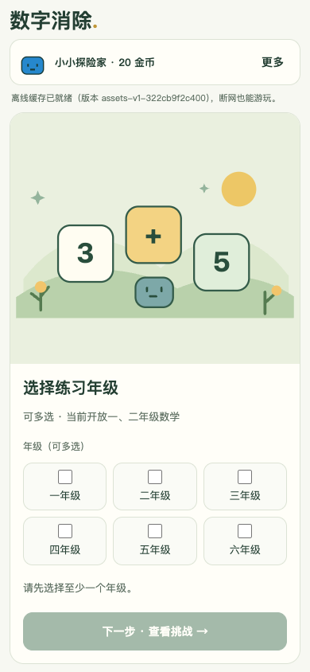

# M7 闭环复核（closure recheck）

复核执行于 2026-10-26 夜间至 2026-10-27 凌晨，报告撰写于 2026-10-27。执行者为工作流代理：主链路、边界场景、离线三条链路由三个独立代理复核会话分别驱动（ego-browser / playwright-cli），本文由报告代理依据各链路执行记录与截图撰写。全部结论为**代理复核**，不代表人工验收、教师评审或真机结论；桌面浏览器模拟通过**不记为真机通过**。

基线 HEAD `6ff89af`（feat(number-puzzle): 扩展数学题型并优化手机单屏交互）。工作区无未提交源码与测试改动；未提交改动仅为本轮文档修正、一处缺陷修复与本目录截图（见「工作区与提交状态」）。本文为新建文件，未改写 `docs/evidence/` 下任何既有文件。

## 环境与版本

- Node v24.2.0 / npm 11.3.0（满足 package.json 的 engines node >=22）。
- 源站与档案：三条链路各用独立源站与本地档案——主链路 `node scripts/serve.mjs 4187`、边界场景 `4188`、离线 `4189`（serve 绑定 127.0.0.1，scripts/serve.mjs:54；各会话结束后均已停止并复验连接拒绝）。
- 构建：复核前 `npm run build` 通过，SW 标记 `assets-v1-9b6c75e3fece`；缺陷修复后重建为 `assets-v1-322cb9f2c400`（web/sw.js:21，本报告撰写时复验 `PRECACHE_URLS` 恰 25 条）。
- 驱动与视口：主链路、边界场景用 ego-browser（无头 Chromium，桌面 Chrome 156 模拟）；离线链路首轮 ego-browser、修复复验用 playwright-cli 0.1.22 的独立 Chrome 实例。视口 320×568、390×844、1280×800（CDP `Emulation.setDeviceMetricsOverride`）及边界场景的 568×320 横屏。
- 交互真实性：按钮与选项用真实 DOM click／键盘事件，棋盘题按 canvas 几何换算派发 `pointerdown`（与 VERIFICATION.md 记载的 M3–M7 证据方法一致）；答案一律从页面题面自行计算；未注入金币／道具、未篡改页面状态，仅只读 IndexedDB 档案作核对。

## 门禁

| 命令 | 结果 |
| --- | --- |
| `npm ci` | 退出码 0（added 1 package, 0 vulnerabilities） |
| `npm run check` | 退出码 0，84 项测试全部通过；本报告撰写时复跑仍 84/84 通过（19.4s） |
| `node --test web/game-style/preview.test.mjs` | 退出码 0（2 项）；本报告撰写时复跑通过 |
| 复核前 `npm run build` | 退出码 0 |
| 修复后 `npm run check` | 退出码 0（本报告撰写时复跑确认） |

测试无失败项；未跳过任何指定步骤的执行（逐链路例外见「限制与未验证项」）。

## 链路一：主链路（端口 4187）

预期与实际（除裁决①涉及的一步外全部通过）：

1. 首页启动：无预览横幅（`#preview-banner`、`#result-preview-note` 均 hidden），提示为正式取题口径「可多选 · 当前开放一、二年级数学」，离线缓存就绪带版本标记，页面无 JS 错误。
2. 一＋二年级混选完整一局：10 题为棋盘点选与选项题混合，9 题按页面题面计算正确作答；第 3 题故意答错——作答后全部选项 disabled（输入锁定）、复活对话框弹出，15 金币购买复活后重答按 RETRY 计 5 分（每题限时 10 秒，src/game/number-puzzle/rules.ts:20）。
3. 暂停→刷新→恢复：第 5 题开局即暂停，刷新后出现恢复入口；恢复后 questionIndex、score、remainingMs、exerciseId、paused 与暂停前逐项一致，倒计时接续并续打至结算。
4. 结算与练习记录：总分 95 · 已完成 10/10 · 首次答对 9/10 · 答错 1 · 超时 0 · 复活 1 · 本局 +23 金币（答题 18＋通关 5），与练习记录新增条目逐项一致；本次完整局成绩恰 1 条且刷新后一致（另 5 条弃局记录见裁决①）。
5. 再来一局与放弃：重开回到第 1/10 题、得分 0；经「放弃本局未结算金币？」确认框放弃后回到选择屏，无挂起挑战、未产生新记录。
6. 三视口（320×568、390×844、1280×800）DOM 检查无水平溢出，可见主按钮全部位于视口内，目视无文字溢出缺字。

截图（相对本目录）：

- 步骤 1：a-main-home-390.png、a-main-availability-390.png
- 步骤 2：a-main-wrong-feedback-390.png、a-main-revive-dialog-390.png
- 步骤 3：a-main-paused-390.png、a-main-restored-390.png、a-main-restored-playing-390.png
- 步骤 4：a-main-settlement-390.png、a-main-records-390.png、a-main-records-after-reload-390.png
- 步骤 5–6：a-main-again-q1-390.png、a-main-again-q1-320.png、a-main-again-q1-1280.png、a-main-select-320.png、a-main-select-390.png、a-main-select-1280.png

## 链路二：边界场景（端口 4188）

预期与实际（全部通过）：

1. 年级可用性：仅勾选三年级（另验证三~六年级组合）时提示「三年级暂无已审核的数学练习。当前开放：一年级、二年级（数学）。」且「开始一局」禁用，无法进入残缺局。
2. 多选半选恢复：第 1 题多选仅选 1 个正确项→刷新→恢复后原选择与倒计时保留，补全提交判对；该局全对完美结算 100 分、+30 金币（钱包 20→50）。
3. 复活与道具边界：最多复活 2 次生效（第 3 次答错不再弹窗、直接进入失败结算）；提醒卡在答错 2 次后开放、每题限一张、高亮正确选项且不代提交；余额不足（5＜15）时复活与加时按钮禁用并提示「还差」金额，「结束挑战」进入失败结算。全程仅用自然获得资源，未注入。
4. 商店与学习入口：金币商店 9 款商品价格、库存与「还差」金额齐全（提醒卡库存 1 与实际消耗一致，未做交易）；21 节课程卡片按所选年级渲染；错题复习恰 2 条，与故意答错的题目一一对应。
5. 横屏 568×320：选择屏、准备屏、游戏屏可见控件几何断言 0 越界（游戏屏主按钮最大右边界 560＜568）、scrollWidth=568 无横向溢出、主按钮无遮挡。

截图（相对本目录）：

- 步骤 1：b-edge-empty-grade-390.png、b-edge-availability-mixed-390.png
- 步骤 2：b-edge-half-select-390.png、b-edge-restore-offer-390.png、b-edge-half-restored-390.png、b-edge-half-submitted-390.png、b-edge-result-perfect-390.png
- 步骤 3：b-edge-revive-dialog-390.png、b-edge-ready-after-revive-390.png、b-edge-revival-limit-result-390.png、b-edge-hint-highlight-390.png、b-edge-revive-insufficient-390.png、b-edge-revive-insufficient-result-390.png
- 步骤 4：b-edge-shop-390.png、b-edge-courses-390.png、b-edge-review-390.png
- 步骤 5：b-edge-landscape-select-568.png、b-edge-landscape-availability-568.png、b-edge-landscape-game-568.png

## 链路三：离线（端口 4189）

预期与实际：

1. 首次在线打开（旧构建 assets-v1-9b6c75e3fece）：SW 安装完成，cache-ready 后提示带版本标记，Cache Storage 恰一个对应缓存且页面受控。此链路同时发现一处产品缺陷（提示行视觉不可见），见裁决②。
2. 杀 serve→关闭页面→离线重开：页面完全由 SW 缓存启动，离线进入成立。
3. 离线完整一局：10 题全部以真实事件正确作答（含多选逐项勾选＋提交与棋盘坐标点击），通关 ★★★ 总分 100、+30 金币（余额 20→50）。
4. 成绩保存：结算后练习记录恰一条「通关 · 100 分 · 首次答对 10/10 · +30 金币」，已离线写入本机档案。
5. 离线刷新与再次开局：页面仍由缓存完整启动，记录、金币 50 与年级设置完好；可再次开局并经返回＋确认放弃干净回到选择屏。
6. 恢复 serve 后刷新：无刷新循环（timeOrigin 不变）、无更新提示、数据完好。
7. 修复复验（新构建 assets-v1-322cb9f2c400）：删除全局隐藏规则后，缓存就绪提示行视觉可见（计算样式 display:block、文本「离线缓存已就绪（版本 assets-v1-322cb9f2c400），断网也能游玩。」、目视确认位于玩家栏下方），preparing／ready 两态文案均可见，SW 受控、Cache Storage 恰一个新版本缓存。

截图（相对本目录）：

- 步骤 1–6（早前轮次产生，文件名与上述步骤序列一一对应，报告撰写时逐张确认存在于本目录）：c-offline-01-online-ready.png、c-offline-02-offline-reopen.png、c-offline-03-offline-availability.png、c-offline-04-offline-game-start.png、c-offline-05-offline-question-choice.png、c-offline-06-offline-question-canvas.png、c-offline-07-offline-settlement.png、c-offline-08-offline-records.png、c-offline-09-offline-reload-records.png、c-offline-10-offline-new-round.png、c-offline-11-online-recovered.png
- 步骤 7（本轮执行记录明确列出的截图）：c-offline-12-online-ready-visible.png

## 失败与裁决

1. 主链路·步骤 4「本源站首次使用应恰有一条本次成绩」——**agentError（非应用缺陷，未改代码）**：驱动脚本分轮执行、轮间隔超过每题 10 秒限时（src/game/number-puzzle/rules.ts:20 `QUESTION_MS = 10_000`），题目超时后经「结束挑战」产生 5 条真实弃局结算记录，复核驱动自身污染了档案。核心断言（本次完整局 95 分恰 1 条且刷新后仍在）已通过。不改代码；后续复核应先清空本源站档案或单会话连贯执行以复现「首次使用恰一条」。
2. 离线·缓存就绪提示视觉不可见——**productBug（已修复并复验）**：HEAD 6ff89af 重写 CSS 时把 d51ffec 中仅局内生效的隐藏规则误扩为全局（web/style.css 原第 83 行 `.offline-notice:not(.status-warning) { display: none; }`），使非警告态离线提示（含缓存就绪版本提示）在所有屏幕不可见；TS 侧显示意图（src/game/number-puzzle/main.ts:869 `notice.hidden = false`）与版本标记设计目的「便于更新验证」（src/game/number-puzzle/offline.ts:149-152）均未变更，原局内规则仍保留（现为 web/style.css:96）。最小修复为仅删除该一行（`git diff web/style.css` 确认无其他改动）；重建后 SW 标记 assets-v1-322cb9f2c400、预缓存 25 条，playwright-cli 独立 Chrome 复验提示行可见（c-offline-12-online-ready-visible.png）。

## 文档审计与修正

文档审计共 11 条发现，9 条已落盘修正（报告撰写时逐处抽查确认在位）：

- PLAN.md:28——受阻项更正为「真机验证、部署确认未闭环」（源码提交已闭环）。
- PLAN.md:41、:50、:61——三处「源码未提交／尚未提交」更正为已随 6ff89af、d51ffec 提交（未推送、未部署的表述保留）。
- PLAN.md:227、:266、:452——「源码提交」项闭环（已随 658af62 提交，并更正 HEAD 停留 93ce007 的过时记录为提交前状态）；「部署位置确认」仍未闭环。
- README.md:25——单局描述补记每题限时、答错开放提醒卡、限时／复活／加时道具消耗金币。
- README.md:50——补记 17 类选择题扩展审核记录（docs/content-review-question-expansion.md，Codex 代理审核）链接。

其余 2 条数字类按「不自动修改、以实测为准核对后再改」保留待办，本报告撰写时复验确仍为旧值：

- README.md:23 题库候选数仍写「一年级 68 道候选、二年级 36,775 道」；当前口径为一年级 1,085、二年级 52,139、共 53,224（tests/generation.test.mjs:22 以分类计数相加断言一年级 11+36+21+555+425+37=1,085，全量池经 `content.select([1,2])` 动态校验；docs/evidence/question-expansion/README.md:20 记录 53,224）。
- README.md:27 预缓存仍写「共 20 个资源」；本轮构建产物 `PRECACHE_URLS` 实测 25 条。

## 工作区与提交状态

- 工作区无未提交源码或测试改动；题型扩展与单屏交互实现已在 6ff89af 提交，挑战学习与金币商店已在 d51ffec 提交。
- 当前未提交改动：PLAN.md（文档审计修正，及 M7–M15 交接指引 +2 行，声明不改变状态、不代表授权）、README.md（审计修正 2 行）、web/style.css（裁决②的 1 行修复）、本目录 47 张截图、docs/m7-m15-agent-handoff.md（新文件）与此前批次遗留的 116 张证据 PNG。
- 本轮复核未执行任何 git 提交、推送或分支操作；提交与推送依用户授权执行。

## 限制与未验证项

- 真机验证（iOS Safari / Android Chrome，M7 验收条件④，PLAN.md:28）未执行；桌面 Chrome 模拟不构成真机通过，M7 仍维持受阻、完成认定待用户裁决。
- 部署位置未经用户确认，部署环境下的 SW 行为未验证（PLAN.md:266 ②）；现以生产构建 + `npm run serve` 本地验收入口替代。
- 离线链路修复复验仅重验被修复的「提示行可见」一步；其余离线步骤结论基于旧构建 assets-v1-9b6c75e3fece，未在新构建上全量重跑（新旧构建差异仅 style.css 一行删除引起的版本标记变化）。
- 主链路未覆盖 568×320 横屏（边界链路已覆盖）；答错与输入锁定瞬间的首帧截图未捕捉到，锁定表现以 DOM 全部选项 disabled 与对话框遮罩截图为证。
- scripts/serve.mjs 的 MIME 表无音频类型（scripts/serve.mjs:13-21，未命中回退 application/octet-stream，scripts/serve.mjs:44），且仅绑定 127.0.0.1（scripts/serve.mjs:54）；音频加载与局域网真机访问路径未验证。
- chrome-devtools-cli 不在本机 PATH（本轮未使用）；ego-browser 与 playwright-cli 已实际运行成功（浏览器可用性经实跑实证）。
- 代理复核不代表教师／家长／教材专家审核；学生可读性、难度与教学效果观察仍未验证（既有缺口），未做屏幕阅读器等无障碍验收。

## 结论

M7 可独立执行部分已基本闭环：门禁与构建全部通过，三条链路在桌面浏览器模拟下按指定步骤执行完毕且核心断言通过，文档审计 9 处修正落盘，唯一产品缺陷（离线提示被全局隐藏）已最小修复并复验。剩余缺口集中于实现者无法单方推进的外部依赖——真机验证与部署位置确认，以及 README 两处数字核对、离线新构建全量重跑等收尾项。桌面模拟结果不记为真机通过。

## 代表界面

